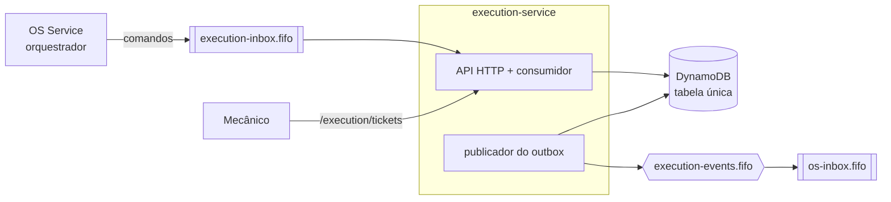
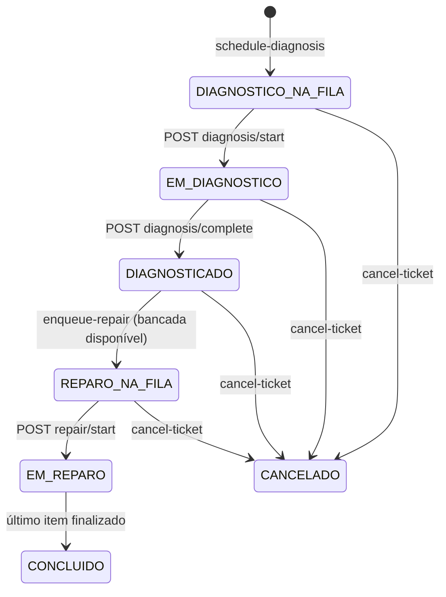

# oficina-mecanica-execution-service

Fila da bancada, diagnóstico e execução das ordens de serviço da oficina
mecânica. Participante da Saga orquestrada pelo
[OS Service](https://github.com/SOAT-15-Oficina/oficina-mecanica-os-service).

A arquitetura do sistema completo, as RFCs e as ADRs vivem no
[oficina-mecanica-infrastructure](https://github.com/SOAT-15-Oficina/oficina-mecanica-infrastructure/tree/main/docs),
em especial a [RFC-0006](https://github.com/SOAT-15-Oficina/oficina-mecanica-infrastructure/blob/main/docs/rfc/0006-microsservicos-e-saga.md)
e a [ADR-0015](https://github.com/SOAT-15-Oficina/oficina-mecanica-infrastructure/blob/main/docs/adr/0015-dynamodb-no-execution-postgresql-no-os-e-billing.md).

## Responsabilidade

| Faz | Não faz |
|---|---|
| mantém a fila da bancada por filial | decide o que entra na OS nem o preço |
| registra início e conclusão do diagnóstico | altera o status da OS (só publica eventos) |
| executa os itens aprovados, um a um | lê o banco de outro serviço |
| recusa o reparo quando a bancada da filial está indisponível | |

## Arquitetura do serviço



| Peça | Tecnologia |
|---|---|
| Linguagem / HTTP | Go 1.26, Fiber v3 |
| Banco | DynamoDB sob demanda, tabela única com GSI `queue` |
| Mensageria | SQS FIFO (entrada), SNS FIFO (saída), outbox no próprio DynamoDB |
| Observabilidade | slog JSON + Datadog APM |
| Deploy | EKS via kustomize, Terraform próprio em `infra/` |

### Modelo de dados

Tabela única (`execution-tickets` local, `oficina-<env>-execution` na AWS),
chave `PK`/`SK`, GSI `queue` (`GSI1PK`/`GSI1SK`, projeção `ALL`) e TTL em
`expires_at`.

| PK | SK | Conteúdo | GSI `queue` |
|---|---|---|---|
| `TICKET#<work_order_id>` | `META` | estado, fase, filial, veículo, técnicos, carimbos de tempo, `saga_id`, `version` | `QUEUE#<filial>#<fase>` / `<enfileirado_em>#<work_order_id>` enquanto o ticket está `*_NA_FILA` |
| `TICKET#<work_order_id>` | `ITEM#<work_order_service_id>` | título, tempo estimado, `PENDENTE`/`EM_EXECUCAO`/`FINALIZADO`, início e fim, posição | — |
| `TICKET#<work_order_id>` | `EVENT#<instante>#<seq>#<sufixo>` | linha do tempo: tipo (a mensagem recebida ou emitida), de/para, autor, item, `message_id` | — |
| `BAY#<filial>` | `META` | disponibilidade da bancada; filial sem item = disponível | — |
| `MSG#<message_id>` | `MSG` | idempotência: `attribute_not_exists(PK)`, `expires_at` = +7 dias | — |
| `OUTBOX#<message_id>` | `OUTBOX` | destino, envelope JSON, contexto de trace | `OUTBOX#PENDING` / `<criado_em>#<id>` até ser publicado |

`<instante>` usa largura fixa (`2006-01-02T15:04:05.000000000Z`) para que a
ordem lexicográfica seja a cronológica.

**Uma transação por efeito.** Cada comando da Saga e cada ação do operador
viram um único `TransactWriteItems` com: `Put` do `META` condicionado a
`version = :v` (ou `attribute_not_exists` na criação), os `ITEM#` e `EVENT#`
alterados, o `MSG#` da mensagem de entrada, o `ConditionCheck` da bancada
quando o reparo é enfileirado e os `OUTBOX#` das mensagens de saída. A versão
no `META` serializa tudo o que muda no ticket, inclusive dois itens
finalizados ao mesmo tempo: só um conclui o reparo. Conflito de versão é
repetido até três vezes; condição do `MSG#` falhando = mensagem duplicada,
ignorada.

**Fila.** `GET /execution/queue` consulta o GSI por `QUEUE#<filial>#<fase>`
em ordem de chegada. O ticket sai da fila (o `META` é regravado sem
`GSI1PK`) quando o diagnóstico ou o reparo começa. A posição enviada em
`diagnosis-scheduled`/`repair-enqueued` é `1 +` quantos tickets da mesma fila
chegaram antes (`Select COUNT` com `GSI1SK < chave`).

**Outbox.** O relay lê `OUTBOX#PENDING` no GSI em ordem de criação (mensagens
da mesma transação recebem nanossegundos crescentes), publica no tópico
`execution-events.fifo` com `MessageGroupId = work_order_id` e
`MessageDeduplicationId = message_id`, e remove `GSI1PK`/`GSI1SK` do item,
que ganha `published_at` e TTL de 7 dias. Como o GSI é eventualmente
consistente, uma mensagem pode ser lida duas vezes logo após publicada; a
deduplicação do SNS FIFO absorve.

### Estados do ticket



Itens: `PENDENTE` → `EM_EXECUCAO` (`items/{id}/start`) → `FINALIZADO`
(`items/{id}/finish`), só com o ticket `EM_REPARO`. Reparo sem itens conclui
no próprio `repair/start`.

### Mensagens

Entrada: `execution-inbox.fifo` (consumidor no processo da API). Saída:
tópico `execution-events.fifo`, sempre via outbox.

| Recebe | Efeito | Responde |
|---|---|---|
| `execution.schedule-diagnosis` | cria o ticket `DIAGNOSTICO_NA_FILA` (filial padrão `MATRIZ`); se já existe, não muda nada | `execution.diagnosis-scheduled` com `queue_position` (0 se não está mais na fila) |
| `execution.enqueue-repair` | bancada indisponível → nada; ticket `DIAGNOSTICADO` (ou inexistente) → grava itens `PENDENTE`, `REPARO_NA_FILA`; já em reparo → nada | `execution.repair-rejected` `BANCADA_INDISPONIVEL`; `execution.repair-enqueued` com `queue_position`; outros estados → `repair-rejected` `ESTADO_INVALIDO` |
| `execution.cancel-ticket` | `CANCELADO` se não estiver `EM_REPARO`/`CONCLUIDO` | `execution.ticket-canceled` **sempre**, mesmo sem ticket |
| outro tipo | marca como processada e loga `execution.message_ignored` | — |

| Ação do operador | Publica |
|---|---|
| `diagnosis/start` | `execution.diagnosis-started` |
| `diagnosis/complete` | `execution.diagnosis-completed` |
| `repair/start` | `execution.repair-started` (+ `repair-completed` se não há itens) |
| `items/{id}/start` | `execution.item-started` |
| `items/{id}/finish` | `execution.item-finished` (+ `execution.repair-completed` no último item) |

Respostas a comandos carregam `causation_id` = `message_id` do comando;
eventos do operador herdam `saga_id` e `correlation_id` gravados no ticket.

## Endpoints

Todos sob `/execution` (o cliente vê `/api/execution`), JWT HS256 com role
`admin` ou `employee` (mesmo `JWT_SECRET_KEY` da Lambda). `/ping`, `/ready`
e o Swagger são públicos.

| Método e rota | Corpo | Respostas |
|---|---|---|
| `GET /execution/queue?branch=MATRIZ&phase=DIAGNOSTICO\|REPARO` | — | 200, 400 |
| `GET /execution/tickets/{workOrderId}` | — | 200 ficha + itens + linha do tempo, 404 |
| `POST /execution/tickets/{workOrderId}/diagnosis/start` | `{"technician":"..."}` | 200, 400, 404, 409 |
| `POST /execution/tickets/{workOrderId}/diagnosis/complete` | `{"notes":"..."}` (opcional) | 200, 404, 409 |
| `POST /execution/tickets/{workOrderId}/repair/start` | `{"technician":"..."}` | 200, 400, 404, 409 |
| `POST /execution/tickets/{workOrderId}/items/{workOrderServiceId}/start` | — | 200, 404, 409 |
| `POST /execution/tickets/{workOrderId}/items/{workOrderServiceId}/finish` | — | 200, 404, 409 |
| `GET /execution/bays/{branch}` | — | 200 |
| `PUT /execution/bays/{branch}/availability` | `{"available":false}` | 200, 400 |

Transição inválida para o estado atual → 409; ticket ou item inexistente →
404; sem JWT → 401; role sem permissão → 403.

## Configuração

| Variável | Padrão | Uso |
|---|---|---|
| `SERVER_PORT` | `8080` | porta HTTP |
| `JWT_SECRET_KEY` | obrigatória | segredo HS256 compartilhado com a Lambda |
| `AWS_DEFAULT_REGION` | `sa-east-1` | |
| `AWS_ENDPOINT_URL` | — | só local (LocalStack) |
| `DYNAMODB_TABLE_NAME` | `execution-tickets` | |
| `MESSAGING_INBOX_QUEUE_URL` | — | fila `execution-inbox.fifo`; vazia desliga o consumidor |
| `MESSAGING_EVENTS_TOPIC_ARN` | — | tópico `execution-events.fifo`, destino do outbox |
| `MESSAGING_POLL_WAIT` | `20s` | long polling do SQS (máximo 20s) |
| `OUTBOX_POLL_INTERVAL` | `500ms` | intervalo do relay |
| `SERVER_ENVIRONMENT`, `APP_BASE_URL`, `DD_*` | | ambiente e observabilidade |

No EKS, `JWT_SECRET_KEY` chega pelo Secret `execution-secrets`, gerado no
deploy a partir do segredo cujo ARN a plataforma publica em
`/oficina-mecanica/<env>/jwt_secret_arn`.

## Como rodar

```bash
cp .env.example .env
docker compose up --build
curl localhost:8092/ping
```

O compose sobe a API (porta 8092) e o LocalStack (porta 4567 no host) com
SQS/SNS FIFO e a tabela DynamoDB com TTL, criados por
`local/localstack/init.sh`. Não há migrations: o schema do DynamoDB é a
tabela e o índice, criados pelo Terraform em `infra/`. O processo da API
roda também o consumidor da inbox e o relay do outbox; SIGTERM encerra o
HTTP e depois os dois.

## Testes e cobertura

```bash
go test ./... -race -coverprofile=coverage.out
./scripts/coverage-gate.sh coverage.out
```

Testes unitários usam stubs da API do DynamoDB e um repositório em memória.
Os testes de integração (`internal/store`, `internal/execution`) rodam
contra o LocalStack quando `AWS_ENDPOINT_URL` está definido e são pulados
caso contrário; o job `test` do CI sobe um service container
`localstack/localstack:4.4` para eles. Para rodar localmente:

```bash
docker run -d --rm --name execution-ls -e SERVICES=dynamodb,sqs,sns -p 4571:4566 localstack/localstack:4.4
AWS_ENDPOINT_URL=http://localhost:4571 AWS_ACCESS_KEY_ID=test AWS_SECRET_ACCESS_KEY=test go test ./... -race
```

O CI reprova abaixo de **80%** no job `test` (`scripts/coverage-gate.sh`) e no
job `quality` (Quality Gate `oficina-fase4` do SonarQube). `cmd/` e `docs/`
ficam fora da métrica.

| Pacote | Só unitários | Com LocalStack |
|---|---|---|
| `internal/auth` | 91,7% | 91,7% |
| `internal/config` | 100% | 100% |
| `internal/execution` | 95,7% | 96,8% |
| `internal/messaging` | 95,6% | 95,6% |
| `internal/observability` | 85,7% | 85,7% |
| `internal/routes` | 99,3% | 99,3% |
| `internal/routes/middlewares` | 96,0% | 96,0% |
| `internal/store` | 94,5% | 94,9% |
| `internal/ticket` | 100% | 100% |
| **total (métrica do gate)** | **95,9%** | **96,2%** |

## Pipeline

| Evento | Jobs |
|---|---|
| PR para `main` ou `hml` | `lint` (actionlint, redocly, terraform validate, kubeconform), `test` (LocalStack como service container, cobertura ≥ 80%), `quality` (SonarQube) |
| push em `hml` | deploy em homologação |
| push em `main` | deploy em produção |
| `destroy.yml` (manual, na branch do ambiente) | remove os objetos do `k8s/` (se o cluster existir) e roda `terraform destroy` em `infra/` |

O deploy aplica `infra/`, gera o Secret com `JWT_SECRET_KEY` (a role de
deploy precisa de `secretsmanager:GetSecretValue` no segredo do JWT),
publica a imagem no ECR, aplica
`k8s/overlays/<ambiente>` e confere `/ping` e o contrato servido.

O `destroy.yml` é disparado pelo `tear-down.yml` do `-infrastructure`, depois
do OS Service (que assina o tópico deste serviço) e antes do destroy da
plataforma. A branch escolhe o ambiente, como no deploy; com o state vazio ele
não faz nada.

## Contrato

- HTTP: [`docs/swagger.yaml`](docs/swagger.yaml), servido em `/api/execution/swagger`.
- Mensagens: catálogo na RFC-0006, seção 5; tipos e payloads em
  `internal/messaging/catalog.go`, idêntico nos três serviços.
