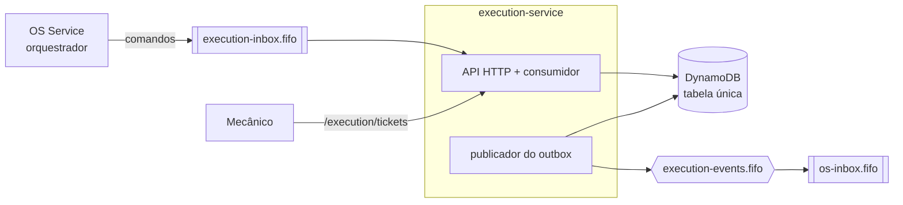

# oficina-mecanica-execution-service

Fila da bancada, diagnóstico e execução das ordens de serviço da oficina
mecânica. Participante da Saga orquestrada pelo
[OS Service](https://github.com/SOAT-15-Oficina/oficina-mecanica-os-service).

A arquitetura do sistema completo, as RFCs e as ADRs vivem no
[oficina-mecanica-infrastructure](https://github.com/SOAT-15-Oficina/oficina-mecanica-infrastructure/tree/main/docs),
em especial a [RFC-0006](https://github.com/SOAT-15-Oficina/oficina-mecanica-infrastructure/blob/main/docs/rfc/0006-microsservicos-e-saga.md)
e a [ADR-0015](https://github.com/SOAT-15-Oficina/oficina-mecanica-infrastructure/blob/main/docs/adr/0015-dynamodb-no-execution-postgresql-no-os-e-billing.md).

## Responsabilidade

| Faz | Não faz |
|---|---|
| mantém a fila da bancada por filial | decide o que entra na OS nem o preço |
| registra início e conclusão do diagnóstico | altera o status da OS (só publica eventos) |
| executa os itens aprovados, um a um | lê o banco de outro serviço |
| recusa o reparo quando a bancada da filial está indisponível | |

## Arquitetura do serviço



| Peça | Tecnologia |
|---|---|
| Linguagem / HTTP | Go 1.26, Fiber v3 |
| Banco | DynamoDB sob demanda, tabela única com GSI `queue` |
| Mensageria | SQS FIFO (entrada), SNS FIFO (saída), outbox no próprio DynamoDB |
| Observabilidade | slog JSON + Datadog APM |
| Deploy | EKS via kustomize, Terraform próprio em `infra/` |

### Modelo de dados

| PK | SK | Conteúdo |
|---|---|---|
| `TICKET#<work_order_id>` | `META` | estado, filial, fase (diagnóstico ou reparo) |
| `TICKET#<work_order_id>` | `ITEM#<id>` | item aprovado e andamento |
| `TICKET#<work_order_id>` | `EVENT#<instante>` | linha do tempo da bancada |
| `MSG#<message_id>` | `MSG` | idempotência (escrita condicional, TTL) |
| `OUTBOX#<id>` | `OUTBOX` | mensagem a publicar |

GSI `queue`: `GSI1PK = QUEUE#<filial>#<estado>`, `GSI1SK = <enfileirado_em>`.

## Como rodar

```bash
cp .env.example .env
docker compose up --build
curl localhost:8092/ping
```

O compose sobe a API e o LocalStack com SQS/SNS FIFO e a tabela DynamoDB,
criados por `local/localstack/init.sh`. Não há migrations: o schema do
DynamoDB é a tabela e o índice, criados pelo Terraform em `infra/`.

## Testes e cobertura

```bash
go test ./... -coverprofile=coverage.out
./scripts/coverage-gate.sh coverage.out
```

O CI reprova abaixo de **80%** no job `test` (`scripts/coverage-gate.sh`) e no
job `quality` (Quality Gate `oficina-fase4` do SonarQube). `cmd/` e `docs/`
ficam fora da métrica.

| Pacote | Cobertura |
|---|---|
| total (métrica do gate) | 93,6% |

## Pipeline

| Evento | Jobs |
|---|---|
| PR para `main` ou `hml` | `lint` (actionlint, redocly, terraform validate, kubeconform), `test` (cobertura ≥ 80%), `quality` (SonarQube) |
| push em `hml` | deploy em homologação |
| push em `main` | deploy em produção |

O deploy aplica `infra/`, publica a imagem no ECR, aplica
`k8s/overlays/<ambiente>` e confere `/ping` e o contrato servido.

## Contrato

- HTTP: [`docs/swagger.yaml`](docs/swagger.yaml), servido em `/api/execution/swagger`.
- Mensagens: catálogo na RFC-0006, seção 5.
